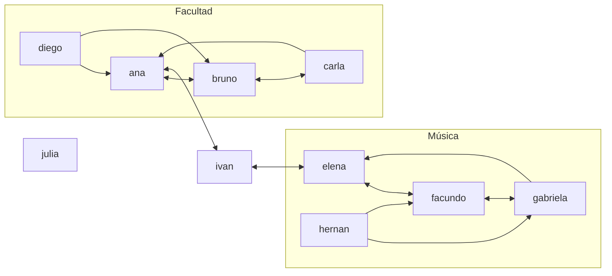

# Modelo social — usuarios, seguimiento, publicaciones y dataset demo

## Alcance

Esta sección documenta el modelo social desarrollado por Dalton: usuarios, relaciones de seguimiento y reciprocidad (primera PR), y posteos, comentarios, compartidos, menciones, feed y alcance de un posteo (segunda PR), con el dataset de ejemplo. No representa todavía el informe final del equipo: faltan las consultas adicionales y la integración con las ramas de algoritmos.

## Organización técnica

El código está en el paquete `ucu.edu.aed.redsocial`, separado de la biblioteca (`ucu.edu.aed.tda.grafo`), para que los algoritmos de grafos no dependan del dominio. `modelo` contiene las entidades (`Usuario`, `Posteo`, `Comentario`, `Compartido` y `EntradaFeed`); `RedSocial` es la API del dominio; `Difusion` es el algoritmo de alcance, genérico y separado del dominio; `GrafoSoloLectura` es una vista del grafo para los algoritmos y `DatosDemo` arma el dataset de ejemplo. Las pruebas están en `Proyecto/src/test/java/ucu/edu/aed/redsocial` y siguen el estilo de las del grafo (`TestCase`, métodos `test...`).

`RedSocial` usa un `DirectedGraph<Usuario, WeightedEdge>`. Cada usuario es un vértice y una arista `A -> B` significa «A sigue a B». Por lo tanto, los seguidos de A son sus **sucesores** y los seguidores de B son sus **predecesores**. Un seguimiento mutuo son dos aristas, `A -> B` y `B -> A`. Todas las aristas pesan 1 (`RedSocial.PESO_SEGUIMIENTO`), así que los grados de separación cuentan saltos; el dato es un `WeightedEdge` porque Dijkstra, Floyd y Warshall lo exigen.

Las adyacencias viven solo en el grafo. Además, `RedSocial` mantiene un índice `id -> Usuario` (`LinkedHashMap`) para resolver ids y validar existencia en O(1), sin pasar por `buscarVertice`, que es lineal. El índice guarda vértices, no relaciones, así que no duplica la lógica de adyacencias.

## Contrato con la biblioteca

Propuesta para validar con Juanchi (responde al pendiente «verificar el contrato de seguimiento con Dalton»):

| Punto | Decisión |
| --- | --- |
| Tipo del grafo | `DirectedGraph<Usuario, WeightedEdge>` |
| Vértice | `Usuario`; su identidad es el `id` (`equals`/`hashCode` solo por id) |
| Arista `A -> B` | A sigue a B |
| Seguidos / seguidores | `successors(A)` / `predecessors(B)` |
| Peso | siempre 1 |
| Auto-seguimiento | prohibido; lo valida `RedSocial`, porque `DirectedGraph` permite autoaristas |
| Seguimiento repetido | lo rechaza el grafo (`agregarArista` devuelve `false`) |
| Acceso para algoritmos | `red.grafoDeSeguimiento()`, vista de solo lectura que se pasa directo a `DirectedGraphAlgorithms` o `SocialGraphQueries` |

Las sugerencias y los grados de separación ya están en `SocialGraphQueries` (PR #6); `RedSocial` los va a usar sobre `grafoDeSeguimiento()` sin reimplementarlos.

## Decisiones de diseño

- **Los posteos no son vértices del grafo de seguimiento.** Si lo fueran, el grafo mezclaría dos tipos de vértice y todos los algoritmos sobre usuarios (BFS, Warshall, centro, articulación) tendrían que filtrarlos. Además, la «distancia» entre un usuario y un posteo no tiene sentido. Posteos, comentarios y compartidos viven en colecciones de `RedSocial` (`Map` por id de posteo) y referencian a los usuarios.
- **Vista de solo lectura.** Si `RedSocial` entregara el grafo real, cualquiera podría agregar `A -> A` y saltearse las reglas del dominio. `GrafoSoloLectura` delega las lecturas (mismo costo, sin copiar) y lanza `UnsupportedOperationException` en las escrituras.
- **Ids normalizados.** `"@Ana"`, `" ana "` y `"ana"` son el mismo usuario. Formato permitido: `[a-z0-9._]{1,30}`, letras sin tilde.
- **Errores.** Igual que en la biblioteca (`SocialGraphQueries`, `obtenerExcentricidad`), toda entrada inválida lanza `IllegalArgumentException` con el motivo en el mensaje: id mal formado, nombre o texto vacío, id repetido, usuario o posteo inexistente, auto-seguimiento, o comentar/compartir un posteo que no le llegó. Seguir, dejar de seguir o compartir de forma redundante no es error: devuelve `false`, como `agregarArista` y `eliminarArista`.
- **Eliminar usuario.** Borra el vértice (el grafo elimina sus aristas salientes y entrantes) y toda su actividad: sus posteos con sus comentarios y compartidos, sus comentarios y compartidos en posteos ajenos y las menciones que le hicieron. El id se puede volver a registrar sin heredar nada.

### Publicaciones y difusión

- **La mención es una relación posteo → usuario.** Se detecta en el texto: cada `@id` de un usuario existente, que no sea el autor, es una mención. Un `@` de alguien que no existe o pegado a otra palabra (un mail) se deja como texto. Se guarda como un conjunto de usuarios dentro de `Posteo` o `Comentario`, porque sus datos (quién, dónde y cuándo) ya son los del posteo o comentario. Por eso no hay una clase `Mencion`. Las menciones de los comentarios cuentan para el posteo comentado.
- **El compartido sí es una clase (`Compartido`).** Tiene datos propios: quién y cuándo. El momento se usa para ordenar el feed.
- **Orden de los eventos.** Publicar, comentar y compartir incrementan un contador global (`reloj`). El feed se ordena con ese contador y no con la hora de la máquina, así la demo y los tests dan siempre lo mismo.
- **Quién puede interactuar.** Solo puede comentar o compartir un posteo su autor (comentar) o alguien a quien le llegó: seguidor de quien lo publicó o compartió, o mencionado. Si no, un compartido no tendría de dónde venir. El autor no puede compartir su propio posteo.
- **Alcance (`Difusion.alcance`).** Es un BFS sobre predecesores (el contenido viaja al revés que las aristas) que solo expande desde los **emisores**: el autor y cada usuario alcanzado que lo compartió. Los mencionados lo reciben aunque no sigan a nadie, y si lo comparten se vuelven emisores: así se cumple el caso de la consigna del mencionado que comparte y lo hace llegar a sus propios seguidores. Los alcanzados van en un conjunto: cada usuario cuenta una vez y los ciclos de seguimiento no generan difusión infinita. El autor no cuenta en su alcance. Seguir a alguien que recibió el posteo no alcanza: tiene que haberlo compartido.
- **Seguidores en una sola pasada.** El alcance necesita los seguidores de cada emisor. Llamar a `predecessors()` por cada emisor costaría O(V + E) cada vez; `Difusion.seguidoresDeCadaVertice` los arma todos juntos recorriendo `aristas()` una sola vez, en O(V + E).
- **Feed.** Son los posteos publicados o compartidos por alguien que el usuario sigue, más los posteos donde lo mencionaron (en el texto o en un comentario). No incluye sus propios posteos. Hay una entrada por posteo, con el motivo más reciente (`PUBLICACION`, `COMPARTIDO` o `MENCION`) y quién lo trajo, ordenadas de la más nueva a la más vieja. Con estas reglas, un usuario tiene un posteo en su feed si y solo si está en su alcance. Un test lo verifica para todos los pares usuario/posteo del dataset.

## Complejidad

Notación: V = cantidad de usuarios; E = cantidad de seguimientos; Δ = cantidad de seguidos del usuario consultado; A = actividad total (posteos + comentarios + compartidos); F = entradas de un feed. Los costos incluyen el `buscarVertice` lineal de `DirectedGraph`.

| Operación | Tiempo | Espacio auxiliar | Observaciones |
| --- | --- | --- | --- |
| `registrarUsuario` | O(1) promedio | O(1) | Índice y `agregarVertice` sobre mapas hash |
| `eliminarUsuario` | O(V + E) | O(1) | `removerVertice` revisa todas las listas para borrar las aristas entrantes |
| `obtenerUsuario` / `existeUsuario` | O(1) promedio | O(1) | Usa el índice, no `buscarVertice` |
| `seguir` | O(Δ) | O(1) | El grafo revisa los seguidos para no duplicar |
| `dejarDeSeguir` | O(V + Δ) | O(1) | `eliminarArista` busca ambos vértices linealmente |
| `sigueA` / `sonMutuos` | O(V + Δ) | O(1) | `existeArista` busca el origen y recorre sus seguidos |
| `seguidos` | O(V + Δ) | O(Δ) | Sucesores |
| `seguidores` | O(V + E) | O(V) | Predecesores: el grafo solo guarda aristas salientes y revisa todas |
| `seguidoresMutuos` | O(V + E) | O(V) | Sucesores ∩ predecesores; la intersección es O(Δ) |
| `eliminarUsuario` (con actividad) | O(V + E + A) | O(P) | Además del vértice, recorre posteos, comentarios y compartidos |
| `publicar` | O(largo del texto) | O(menciones) | Cada mención se resuelve en el índice en O(1) |
| `alcance` | O(V + E + A) | O(V + E) | Seguidores en una pasada + BFS que visita cada vértice y arista una vez |
| `comentar` / `compartir` | O(V + E + A) | O(V + E) | Verifican que el posteo le haya llegado calculando el alcance |
| `feed` | O(V + Δ + A + F log F) | O(F) | Recorre toda la actividad y ordena las entradas |

Candidatas para el Desafío 3:

- `seguidores` (y todo lo que dependa de predecesores) es la operación más cara para su resultado. Guardar también la lista de predecesores la baja a O(V + grado de entrada), a cambio de más memoria y de mantener dos listas en cada alta y baja.
- `feed` recorre toda la actividad de la red aunque al usuario le lleguen pocos posteos. Con índices por usuario (posteos por autor, compartidos por usuario, menciones por usuario) bajaría a O(V + actividad de sus seguidos + sus menciones).
- `comentar` y `compartir` recalculan el alcance completo para validar. Guardar el alcance de cada posteo y actualizarlo incrementalmente evitaría recalcularlo en cada interacción.

## Dataset demo

`DatosDemo.crearRedDemo()` arma siempre la misma red, en el mismo orden: 10 usuarios, 18 seguimientos y 3 posteos.



| Caso | Dónde |
| --- | --- |
| Seguimientos mutuos | ana-bruno, bruno-carla, ana-ivan, ivan-elena, elena-facundo, facundo-gabriela |
| Ciclo dirigido | ana → bruno → carla → ana |
| Seguimiento no recíproco | carla → ana, gabriela → elena |
| Nadie los sigue | diego, hernan |
| Puente entre comunidades | ivan es el único vínculo; en la proyección no dirigida los puntos de articulación son ana, ivan y elena |
| Aislado | julia |
| Camino largo | diego → ana → ivan → elena → facundo (4 saltos); facundo no llega a diego (-1) |
| Sugerencias para diego | carla (la sigue bruno) e ivan (lo sigue ana): 1 conexión en común cada uno; el empate se resuelve por orden de registro |

Publicaciones, en este orden:

| Posteo | Actividad | Caso que cubre |
| --- | --- | --- |
| p1 de carla | Menciona a @gabriela (de la otra comunidad, no sigue a carla). gabriela lo comparte, bruno lo comparte y facundo comenta. | **Caso de la consigna:** la mencionada comparte y le llega a sus seguidores (facundo, hernan). Cruza de comunidad sin pasar por ivan. |
| p2 de elena | ivan lo comparte, ana lo comparte, diego comenta arrobando a @julia. | Cadena de compartidos con ciclo (ana ↔ ivan no lo repite); mención en un comentario a una usuaria aislada; hernan no lo recibe porque quienes sigue lo recibieron pero no lo compartieron. |
| p3 de julia | Ninguna. | Usuaria aislada: alcance vacío. |

Salida esperada de `DatosDemo.main`:

```
Usuarios: 10 | Seguimientos: 18
usuario    sigue a                          lo siguen                        mutuos
@ana       bruno, ivan                      bruno, carla, diego, ivan        bruno, ivan
@bruno     ana, carla                       ana, carla, diego                ana, carla
@carla     bruno, ana                       bruno                            bruno
@diego     ana, bruno                       -                                -
@ivan      ana, elena                       ana, elena                       ana, elena
@elena     ivan, facundo                    ivan, facundo, gabriela          ivan, facundo
@facundo   elena, gabriela                  elena, gabriela, hernan          elena, gabriela
@gabriela  facundo, elena                   facundo, hernan                  facundo
@hernan    gabriela, facundo                -                                -
@julia     -                                -                                -

Posteos: 3
p1 de @carla: "Alguien tiene los ejercicios de grafos? @gabriela vos hiciste el curso"
    compartido por: gabriela, bruno
    mencionados:    gabriela
    alcance:        gabriela, bruno, facundo, hernan, ana, diego
p2 de @elena: "Ensayo abierto el sabado, estan todos invitados"
    compartido por: ivan, ana
    mencionados:    julia
    alcance:        julia, ivan, facundo, gabriela, ana, bruno, carla, diego
p3 de @julia: "Hola, recien llego a la red"
    compartido por: -
    mencionados:    -
    alcance:        -

Feeds:
@ana       [p2 (compartido por @ivan), p1 (compartido por @bruno)]
@bruno     [p2 (compartido por @ana), p1 (publicado por @carla)]
@carla     [p2 (compartido por @ana)]
@diego     [p2 (compartido por @ana), p1 (compartido por @bruno)]
@ivan      [p2 (compartido por @ana)]
@elena     -
@facundo   [p2 (publicado por @elena), p1 (compartido por @gabriela)]
@gabriela  [p2 (publicado por @elena), p1 (mencion de @carla)]
@hernan    [p1 (compartido por @gabriela)]
@julia     [p2 (mencion de @diego)]
```

Para recrearlo: `mvn test` desde `Proyecto/` corre toda la suite (incluye `DatosDemoTest`, que fija esta salida), y la tabla se imprime ejecutando `DatosDemo.main` desde el IDE o con `mvn compile exec:java -Dexec.mainClass=ucu.edu.aed.redsocial.DatosDemo`. Si alguien cambia el dataset, `DatosDemoTest` falla y hay que actualizar esta sección.

## Pruebas y estado de integración

- `RedSocialTest` (22 pruebas): registro y normalización de ids, entradas inválidas, seguir y dejar de seguir, duplicados, auto-seguimiento, mutuos, aislados, eliminación de usuarios con sus aristas entrantes y salientes, usuarios inexistentes y vista de solo lectura.
- `PublicacionesTest` (21 pruebas): publicar, menciones (válidas, repetidas, al autor, mails, inexistentes), mención sin seguimiento, mención en comentario, cadena de compartidos, ciclo mutuo, caso de la consigna, aislado, compartir o comentar sin haberlo recibido, compartido repetido, orden del feed, feed = alcance y eliminación de usuarios con actividad.
- `DifusionTest` (10 pruebas): el algoritmo de alcance sobre un grafo de Strings, sin el dominio (cadena, reemisor que no lo recibió, mencionado que comparte, ciclo, mutuos, aislado, entradas inválidas).
- `DatosDemoTest` (14 pruebas): tamaño, reproducibilidad, relaciones esperadas, puente, aislado, ciclo, conectividad débil, alcances y feeds esperados, y feed = alcance para todos los pares usuario/posteo.

La suite completa (113 pruebas, contando las del grafo) pasa sobre `main`. Todavía no se probó contra las ramas de Warshall, recorridos y consultas (PR #4, #5 y #6) ni contra la rama de Gerónimo.

## Puntos para la defensa oral

1. Justificar el grafo dirigido: seguir a alguien no implica reciprocidad; un mutuo son dos aristas.
2. Explicar por qué los seguidores son predecesores y por qué cuestan O(V + E) con esta representación.
3. Justificar por qué los posteos no son vértices del grafo de seguimiento.
4. Explicar por qué el auto-seguimiento se valida en `RedSocial` y no en el grafo (el grafo es genérico y debe respetar su TDA).
5. Explicar para qué sirve el índice `id -> Usuario` y por qué no duplica adyacencias.
6. Explicar la vista de solo lectura como decisión de encapsulamiento.
7. Recorrer el dataset demo y qué caso cubre cada usuario y cada posteo.
8. Explicar el alcance como BFS sobre predecesores que solo expande desde emisores, y por qué los ciclos no lo vuelven infinito.
9. Explicar por qué la mención es posteo → usuario y por qué `Compartido` es una clase y la mención no.
10. Justificar por qué solo puede compartir quien recibió el posteo, y por qué con eso feed y alcance coinciden.

## Pendientes antes de entregar

- Confirmar el contrato con Juanchi y que `SocialGraphQueries` funciona sobre la vista de solo lectura.
- Acordar con Gerónimo la proyección no dirigida para comunidades y puentes (¿arista si hay seguimiento en cualquier sentido, o solo mutuos?).
- Definir las cinco consultas adicionales.
- Actualizar esta sección con los resultados de la ejecución integrada.
