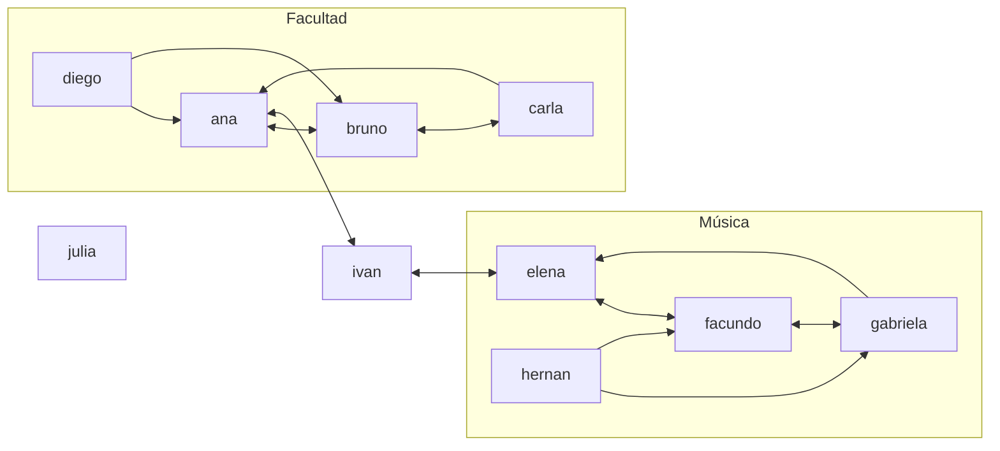

# Modelo social — usuarios, seguimiento y dataset demo

## Alcance

Esta sección documenta el modelo social desarrollado por Dalton: usuarios, relaciones de seguimiento, reciprocidad y el dataset de ejemplo. No representa todavía el informe final del equipo: faltan posteos, comentarios, menciones y alcance (próxima PR), las consultas adicionales y la integración con las ramas de algoritmos.

## Organización técnica

El código está en el paquete `ucu.edu.aed.redsocial`, separado de la biblioteca (`ucu.edu.aed.tda.grafo`), para que los algoritmos de grafos no dependan del dominio. `modelo` contiene `Usuario`; `RedSocial` es la API del dominio; `GrafoSoloLectura` es una vista del grafo para los algoritmos y `DatosDemo` arma el dataset de ejemplo. Las pruebas están en `Proyecto/src/test/java/ucu/edu/aed/redsocial` y siguen el estilo de las del grafo (`TestCase`, métodos `test...`).

`RedSocial` usa un `DirectedGraph<Usuario, WeightedEdge>`. Cada usuario es un vértice y una arista `A -> B` significa «A sigue a B». Por lo tanto, los seguidos de A son sus **sucesores** y los seguidores de B son sus **predecesores**. Un seguimiento mutuo son dos aristas, `A -> B` y `B -> A`. Todas las aristas pesan 1 (`RedSocial.PESO_SEGUIMIENTO`), así que los grados de separación cuentan saltos; el dato es un `WeightedEdge` porque Dijkstra, Floyd y Warshall lo exigen.

Las adyacencias viven solo en el grafo. Además, `RedSocial` mantiene un índice `id -> Usuario` (`LinkedHashMap`) para resolver ids y validar existencia en O(1), sin pasar por `buscarVertice`, que es lineal. El índice guarda vértices, no relaciones, así que no duplica la lógica de adyacencias.

## Contrato con la biblioteca

Propuesta para validar con Juanchi (responde al pendiente «verificar el contrato de seguimiento con Dalton»):

| Punto | Decisión |
| --- | --- |
| Tipo del grafo | `DirectedGraph<Usuario, WeightedEdge>` |
| Vértice | `Usuario`; su identidad es el `id` (`equals`/`hashCode` solo por id) |
| Arista `A -> B` | A sigue a B |
| Seguidos / seguidores | `successors(A)` / `predecessors(B)` |
| Peso | siempre 1 |
| Auto-seguimiento | prohibido; lo valida `RedSocial`, porque `DirectedGraph` permite autoaristas |
| Seguimiento repetido | lo rechaza el grafo (`agregarArista` devuelve `false`) |
| Acceso para algoritmos | `red.grafoDeSeguimiento()`, vista de solo lectura que se pasa directo a `DirectedGraphAlgorithms` o `SocialGraphQueries` |

Las sugerencias y los grados de separación ya están en `SocialGraphQueries` (PR #6); `RedSocial` los va a usar sobre `grafoDeSeguimiento()` sin reimplementarlos.

## Decisiones de diseño

- **Los posteos no son vértices del grafo de seguimiento.** Si lo fueran, el grafo mezclaría dos tipos de vértice y todos los algoritmos sobre usuarios (BFS, Warshall, centro, articulación) tendrían que filtrarlos. Además, la «distancia» entre un usuario y un posteo no tiene sentido. Los posteos van a vivir en colecciones auxiliares y referencian usuarios por id.
- **Vista de solo lectura.** Si `RedSocial` entregara el grafo real, cualquiera podría agregar `A -> A` y saltearse las reglas del dominio. `GrafoSoloLectura` delega las lecturas (mismo costo, sin copiar) y lanza `UnsupportedOperationException` en las escrituras.
- **Ids normalizados.** `"@Ana"`, `" ana "` y `"ana"` son el mismo usuario. Formato permitido: `[a-z0-9._]{1,30}`. Sirve para cuando se reconozcan menciones con @ en el texto.
- **Errores.** Igual que en la biblioteca (`SocialGraphQueries`, `obtenerExcentricidad`), toda entrada inválida lanza `IllegalArgumentException` con el motivo en el mensaje: id mal formado, nombre vacío, id repetido, usuario inexistente o auto-seguimiento. Seguir o dejar de seguir de forma redundante no es error: devuelve `false`, como `agregarArista` y `eliminarArista`.
- **Eliminar usuario.** Borra el vértice y el grafo elimina sus aristas salientes y entrantes, así que no quedan seguimientos colgando. El id se puede volver a registrar sin heredar relaciones viejas.

### Propuesta para la próxima PR

- `Posteo`: id, autor, texto, orden de creación, ids mencionados e ids que lo compartieron. `Comentario`: id, posteo, autor, texto e ids mencionados.
- La mención es una relación posteo → usuario. Para influencia o sugerencias se puede derivar un conteo usuario → usuario, pero no entra al grafo de seguimiento.
- Alcance: BFS sobre predecesores (seguidores) que expande solo desde emisores (el autor y quienes compartieron después de recibirlo), más los mencionados. Los visitados van en un conjunto: cada usuario cuenta una vez y los ciclos no generan difusión infinita.

## Complejidad

Notación: V = cantidad de usuarios; E = cantidad de seguimientos; Δ = cantidad de seguidos del usuario consultado. Los costos incluyen el `buscarVertice` lineal de `DirectedGraph`.

| Operación | Tiempo | Espacio auxiliar | Observaciones |
| --- | --- | --- | --- |
| `registrarUsuario` | O(1) promedio | O(1) | Índice y `agregarVertice` sobre mapas hash |
| `eliminarUsuario` | O(V + E) | O(1) | `removerVertice` revisa todas las listas para borrar las aristas entrantes |
| `obtenerUsuario` / `existeUsuario` | O(1) promedio | O(1) | Usa el índice, no `buscarVertice` |
| `seguir` | O(Δ) | O(1) | El grafo revisa los seguidos para no duplicar |
| `dejarDeSeguir` | O(V + Δ) | O(1) | `eliminarArista` busca ambos vértices linealmente |
| `sigueA` / `sonMutuos` | O(V + Δ) | O(1) | `existeArista` busca el origen y recorre sus seguidos |
| `seguidos` | O(V + Δ) | O(Δ) | Sucesores |
| `seguidores` | O(V + E) | O(V) | Predecesores: el grafo solo guarda aristas salientes y revisa todas |
| `seguidoresMutuos` | O(V + E) | O(V) | Sucesores ∩ predecesores; la intersección es O(Δ) |

`seguidores` (y todo lo que dependa de predecesores, como el alcance de un posteo) es la operación más cara para su resultado. Es candidata para el Desafío 3: guardar también la lista de predecesores la baja a O(V + grado de entrada), a cambio de más memoria y de mantener dos listas en cada alta y baja.

## Dataset demo

`DatosDemo.crearRedDemo()` arma siempre la misma red, en el mismo orden: 10 usuarios y 18 seguimientos.



| Caso | Dónde |
| --- | --- |
| Seguimientos mutuos | ana-bruno, bruno-carla, ana-ivan, ivan-elena, elena-facundo, facundo-gabriela |
| Ciclo dirigido | ana → bruno → carla → ana |
| Seguimiento no recíproco | carla → ana, gabriela → elena |
| Nadie los sigue | diego, hernan |
| Puente entre comunidades | ivan es el único vínculo; en la proyección no dirigida los puntos de articulación son ana, ivan y elena |
| Aislado | julia |
| Camino largo | diego → ana → ivan → elena → facundo (4 saltos); facundo no llega a diego (-1) |
| Sugerencias para diego | carla (la sigue bruno) e ivan (lo sigue ana): 1 conexión en común cada uno; el empate se resuelve por orden de registro |

Salida esperada de `DatosDemo.main`:

```
Usuarios: 10 | Seguimientos: 18
usuario    sigue a                          lo siguen                        mutuos
@ana       bruno, ivan                      bruno, carla, diego, ivan        bruno, ivan
@bruno     ana, carla                       ana, carla, diego                ana, carla
@carla     bruno, ana                       bruno                            bruno
@diego     ana, bruno                       -                                -
@ivan      ana, elena                       ana, elena                       ana, elena
@elena     ivan, facundo                    ivan, facundo, gabriela          ivan, facundo
@facundo   elena, gabriela                  elena, gabriela, hernan          elena, gabriela
@gabriela  facundo, elena                   facundo, hernan                  facundo
@hernan    gabriela, facundo                -                                -
@julia     -                                -                                -
```

Para recrearlo: `mvn test` desde `Proyecto/` corre toda la suite (incluye `DatosDemoTest`, que fija esta salida), y la tabla se imprime ejecutando `DatosDemo.main` desde el IDE o con `mvn compile exec:java -Dexec.mainClass=ucu.edu.aed.redsocial.DatosDemo`. Si alguien cambia el dataset, `DatosDemoTest` falla y hay que actualizar esta sección.

## Pruebas y estado de integración

- `RedSocialTest` (22 pruebas): registro y normalización de ids, entradas inválidas, seguir y dejar de seguir, duplicados, auto-seguimiento, mutuos, aislados, eliminación de usuarios con sus aristas entrantes y salientes, usuarios inexistentes y vista de solo lectura.
- `DatosDemoTest` (8 pruebas): tamaño, reproducibilidad, relaciones esperadas, puente, aislado, ciclo y conectividad débil.

La suite completa (76 pruebas, contando las del grafo) pasa sobre `main`. Todavía no se probó contra las ramas de Warshall, recorridos y consultas (PR #4, #5 y #6) ni contra la rama de Gerónimo.

## Puntos para la defensa oral

1. Justificar el grafo dirigido: seguir a alguien no implica reciprocidad; un mutuo son dos aristas.
2. Explicar por qué los seguidores son predecesores y por qué cuestan O(V + E) con esta representación.
3. Justificar por qué los posteos no son vértices del grafo de seguimiento.
4. Explicar por qué el auto-seguimiento se valida en `RedSocial` y no en el grafo (el grafo es genérico y debe respetar su TDA).
5. Explicar para qué sirve el índice `id -> Usuario` y por qué no duplica adyacencias.
6. Explicar la vista de solo lectura como decisión de encapsulamiento.
7. Recorrer el dataset demo y qué caso cubre cada usuario.

## Pendientes antes de entregar

- Confirmar el contrato con Juanchi y que `SocialGraphQueries` funciona sobre la vista de solo lectura.
- Acordar con Gerónimo la proyección no dirigida para comunidades y puentes (¿arista si hay seguimiento en cualquier sentido, o solo mutuos?).
- Implementar posteos, comentarios, menciones, feed y alcance; ampliar el dataset con publicaciones.
- Definir las cinco consultas adicionales.
- Actualizar esta sección con los resultados de la ejecución integrada.
